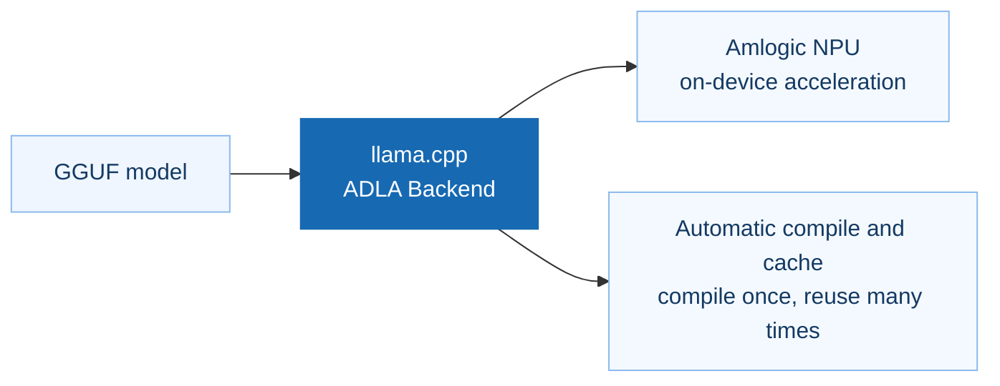
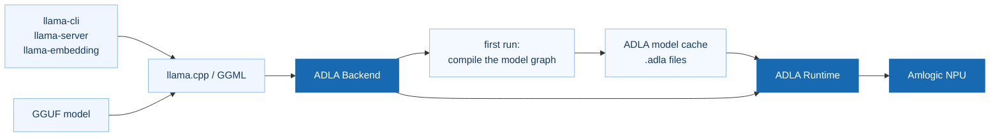

# llama.cpp for the ADLA NPU

This is llama.cpp on the Amlogic ADLA NPU. 

**Make llama.cpp work together with the Amlogic NPU, and keep on-device model
deployment simple.**



- **Native to llama.cpp**: connects through the ADLA Backend, so the familiar
  GGUF models and toolchain keep working.
- **Uses the on-device NPU**: supported model computation is offloaded to the
  Amlogic ADLA NPU, serving on-device LLM and embedding workloads.
- **Deployment works out of the box**: the first inference compiles and caches
  the model, later runs reuse the cache; artifacts can also be generated on an
  x86 host and copied to the board.
- **Flexible integration**: command line and service mode, covering chat, text
  generation and embeddings.

### Architecture



### Environment Requirement

- Chip: A311Y3
- NNSDK：v1.2.0 or higher
- Model: GGUF with Q4_0/Q8_0 quantization
- Disk space: 1-4GB free for each model compiling
- OS: Amlbian (Debian)

## 2. Usage

### 2.1 Quick start

[Download Prebuit binary](https://github.com/Amlogic-NN/amlnn-llama.cpp/releases/tag/v0.7.0-aml) 

```sh
cd aarch64
export LD_LIBRARY_PATH=$(pwd):$LD_LIBRARY_PATH
export GGML_ADLA_OUTPUT_DIR=$PWD/adla_output

# text generation
./llama-cli -m /path/Qwen3-0.6B-Q8_0.gguf -ngl 99 -p "Hello" -n 64

# OpenAI-compatible server
./llama-server -m /path/Qwen3-0.6B-Q8_0.gguf -ngl 99 --port 8080

# embeddings
./llama-embedding -m /path/embeddinggemma-2-Q8_0.gguf -ngl 99 \
    -p "some text" -b 512 -c 512 --embd-normalize -1
```

The first run of a model writes its artifacts into `GGML_ADLA_OUTPUT_DIR` (one
to three minutes for a decoder model, longer for long-context embeddings); later
runs reuse them.

### 2.2 Entry points

| Program | Use |
|---|---|
| `llama-cli` | interactive or one-shot generation |
| `llama-server` | HTTP API (`/v1/chat/completions`, `/v1/completions`, `/v1/embeddings`) |
| `llama-embedding` | embedding vectors on stdout |
| `llama-simple` | smallest example, useful to check an installation |

`-ngl 99` moves the model to the NPU. Do not add `-dev ADLA`: pinning the device
list to the single accelerator removes the CPU fallback from the scheduler, and
the ops the backend does not execute then read stale data (the output degrades
into garbage tokens, and decode gets slower).

Embedding models are detected automatically and take the whole-model encoder
path, with no configuration needed. Setting `GGML_ADLA_ENCODER=0` turns that off
and falls back to the generic per-op path: it still completes, but it is much
slower and less accurate (cosine about 0.94 instead of 0.9996 against a CPU
reference), so it is only useful for debugging.

### 2.3 Environment variables

| Variable | Meaning |
|---|---|
| `GGML_ADLA_OUTPUT_DIR` | artifact cache directory, default `./adla_output/` |
| `GGML_ADLA_MODEL_NAME` | override the cache file prefix (default: `general.name` plus the quantization from the GGUF) |

### 2.4 Artifact cache

Artifacts are named `<model>_<quant>_<graph key>_....adla`, where `<model>` and
`<quant>` come from the GGUF (`general.name`, `general.file_type`). Each model
gets its own set:

| Model | Files | Size |
|---|---|---|
| Qwen3-0.6B | 30 | 854 MB |
| Qwen3.5-0.8B | 8 | 1.3 GB |
| MiniCPM5-1B | 26 | 1.5 GB |
| VLLM-D3-Lite | 8 | 1.3 GB |
| EmbeddingGemma2 | 3 | 3.3 GB |

Deleting the directory forces a rebuild; changing the quantization produces a
different prefix, so old files never shadow the new ones.

### 2.5 Generating artifacts ahead of time (x86 host)

`scripts/adla-compile.sh` runs each model once on an x86 host, which produces the
whole artifact set without an NPU. Copy the result to the board and point
`GGML_ADLA_OUTPUT_DIR` at it.

```sh
# first edit models.txt: name|model path|mode|ctx   (mode is chat or embed)
./scripts/adla-compile.sh -d x86 -o adla_output -m scripts/models.txt
```

The script prints one line per model: elapsed time, file count, size. Each model
needs 1-4 GB of free disk while it runs.

## 3. Performance

Measured on an a9 development board (15 GiB RAM), artifacts already generated,
temperature 0.

### 3.1 Text generation

Prefill is the prompt-processing rate, decode is the generation rate after
prefill (both in tokens/s). Conditions: 512-token prompt, 32 generated tokens.

| Model | Quant | Prefill (tok/s) | Decode (tok/s) |
|---|---|---|---|
| Qwen3-0.6B | Q8_0 | 62 | 15 |
| Qwen3.5-0.8B | Q8_0 | 172 | 14 |
| MiniCPM5-1B | Q8_0 | 78 | 14 |

Prefill scales with the number of prompt tokens; decode is nearly constant while
the context fits the attention window, and degrades once the window has to be
gathered across the whole KV cache.

### 3.2 EmbeddingGemma2

End-to-end time for one input, including tokenization and pooling:

| Input tokens | Time |
|---|---|
| 128 | 0.16 s |
| 512 | 0.64 s |
| 1024 | 3.5 s |
| 2048 | 7.8 s |
| 4096 | 16.7 s |

**Note**: the times above are measured from the second and later requests to
`llama-server` (model already loaded and warm); the first request includes the
model load time.

When serving embeddings through `llama-server`, pass `-ub` at least as large as
the longest input you expect (for example `-ub 4096`). The default micro-batch
is small, and a longer request fails with "input is too large ... increase the
physical batch size".

## 4. Numerical stability

### 4.1 Why results differ from a CPU run

The ADLA NPU executes a different instruction sequence than a CPU: weights are
repacked, activations are kept at reduced precision between layers, and large
matrix products are accumulated in a different order. Bit-identical results are
therefore not attainable on this platform. The differences stay in the low-order
bits, which is why the metrics below track agreement of the *result* (identical
tokens, cosine similarity of embeddings) rather than raw value equality.

### 4.2 Text generation

Greedy decoding only answers "same token or not", which is not enough to
describe what the sampler does when several candidates are close. The metrics
below describe the token distribution the sampler sees at each step, compared
against a CPU run of the same model with the same prompt on the host.

| Metric | Meaning |
|---|---|
| top-1 | the most likely token is the same |
| saturated | top-1 probability >= 0.9, so top-p sampling can only pick that token: the step is backend independent |
| TVD | total variation distance between the two softmax distributions; no token's selection probability moves by more than this value |
| nucleus | Jaccard overlap of the top-p (0.9) candidate sets |
| same-draw | sum of p_i * q_i: the chance that two sampler draws, one per backend, pick the same token |

Conditions: 512-token prompt, temperature 0; the reference is a pure CPU build
of the same llama.cpp version (no NPU, and it shares no code path with the
backend).

| Model | Steps | top-1 | saturated | TVD median | TVD max | nucleus | same-draw |
|---|---|---|---|---|---|---|---|
| Qwen3-0.6B | 13 | 13/13 | 12/13 | 0.0029 | 0.172 | 0.96 | 0.98 |
| Qwen3.5-0.8B | 14 | 14/14 | 13/14 | 0.0025 | 0.117 | 0.96 | 0.99 |
| MiniCPM5-1B | 13 | 13/13 | 12/13 | 0.0023 | 0.126 | 0.96 | 0.98 |

Reading the table:

- 12-13 of the steps are saturated by the top token, so sampling cannot diverge
  there at all.
- In the remaining steps TVD has a median of about 0.3 percent: the token order
  is unchanged, only the probabilities move slightly.
- The TVD maxima (0.12-0.17) occur on the first steps after prefill, where the
  leading candidates are nearly tied, yet the sampled token still matches.

The tested envelope is a 512-token prefill and a few tens of decoding steps.
Longer contexts run, but were not part of this measurement: treat them as
numerically close, not token identical. Keep the context within 80% of the value
declared by the model (or 8k, whichever is smaller) - beyond that the accuracy
degrades quickly.

### 4.3 EmbeddingGemma2

Compared with the same model on a host CPU (llama.cpp v0.7.0), both embeddings
L2-normalized:

| Input tokens | Cosine | Max abs | MAE |
|---|---|---|---|
| 128 | 0.99957646 | 8.51e-03 | 7.72e-04 |
| 256 | 0.99948436 | 9.05e-03 | 8.30e-04 |
| 512 | 0.99932283 | 7.54e-03 | 1.00e-03 |
| 1024 | 0.99927455 | 8.79e-03 | 1.03e-03 |
| 2048 | 0.99885305 | 1.07e-02 | 1.31e-03 |
| 4096 | 0.99824468 | 1.36e-02 | 1.61e-03 |

Cosine stays above 0.998 over the whole tested range. Vectors are not
bit-identical to a CPU result: retrieval pipelines should use a similarity
threshold (0.99 and above) rather than exact comparison.

## 5. Supported models

| Model | Quant | Status | Notes |
|---|---|---|---|
| Qwen3-0.6B | Q8_0 | supported | |
| Qwen3.5-0.8B | Q8_0 | supported | |
| MiniCPM5-1B | Q8_0 | supported | |
| VLLM-D3-Lite | Q8_0 | experimental | - |
| EmbeddingGemma2 | Q8_0 | supported | context up to 4096 tokens |

## 6. Limitations

- Long-context embeddings need a 1.6 GB artifact the first time, which takes a
  few minutes to generate.
- The NPU path depends on the driver libraries from the board image; this
  package does not ship them.
- `VLLM-D3-Lite` is experimental: stable execution and correct output are not
  guaranteed.
- Multimodal input (mmproj) is not supported on current version (run on CPU).

# llama.cpp


<div align="center">

<b>LLM inference in C/C++</b>

[](https://opensource.org/licenses/MIT)
[](https://github.com/ggml-org/llama.cpp/releases?q=tag:v0)
[](https://github.com/ggml-org/llama.cpp/releases?q=b)
[](https://github.com/ggml-org/llama.cpp/actions/workflows/server.yml)
[](https://github.com/ggml-org/llama.cpp/actions/workflows/docker.yml)
[](https://github.com/ggml-org/llama.cpp/actions/workflows/winget.yml)

[ggml](https://github.com/ggml-org/ggml) / [ops](https://github.com/ggml-org/llama.cpp/blob/master/docs/ops.md) / [maintainer PRs](https://github.com/ggml-org/llama.cpp/issues?q=is%3Apr%20is%3Aopen%20draft%3AFalse%20(author%3Argerganov%20OR%20author%3AKitaitiMakoto%20OR%20author%3Adanbev%20OR%20author%3Aaldehir%20OR%20author%3Amax-krasnyansky%20OR%20author%3ACISC%20OR%20author%3Aggerganov%20OR%20author%3Aam17an%20OR%20author%3Ajhen0409%20OR%20author%3Abartowski1182%20OR%20author%3Anikwen%20OR%20author%3Ahipudding%20OR%20author%3Aravi9%20OR%20author%3AServeurpersoCom%20OR%20author%3Apwilkin%20OR%20author%3Areeselevine%20OR%20author%3Angxson%20OR%20author%3Ajeffbolznv%20OR%20author%3Amarty1885%20OR%20author%3A0cc4m%20OR%20author%3ATitaniumtown%20OR%20author%3Aangt%20OR%20author%3AIMbackK%20OR%20author%3Aarthw%20OR%20author%3AJohannesGaessler%20OR%20author%3AORippler%20OR%20author%3Aruixiang63%20OR%20author%3Axctan%20OR%20author%3Aallozaur%20OR%20author%3Ayomaytk%20OR%20author%3Aaendk%20OR%20author%3Awine99%20OR%20author%3Agaugarg-nv%20OR%20author%3Ataronaeo%20OR%20author%3Aforforever73%20OR%20author%3Alhez%20OR%20author%3Anetrunnereve%20OR%20author%3Afairydreaming)%20sort%3Aupdated-desc) / [dev stats](https://github.com/ggml-org/llama.cpp-dev) / [lib llama API](https://github.com/ggml-org/llama.cpp/issues/9289) / [llama-server REST API](https://github.com/ggml-org/llama.cpp/issues/9291)

</div>

## Quick start

A few options to get `llama.cpp` installed on your machine:

```bash
# curl
curl -LsSf https://llama.app/install.sh | sh

# powershell
irm https://llama.app/install.ps1 | iex
```

- Visit https://llama.app and follow the instructions
- Run with Docker - see our [Docker documentation](docs/docker.md)
- Download pre-built binaries from the [releases page](https://github.com/ggml-org/llama.cpp/releases)
- Build from source by cloning this repository - check out [our build guide](docs/build.md)

Once installed:

```sh
# Download and run a model directly from Hugging Face
llama cli -hf ggml-org/Qwen3.5-0.8B-GGUF

# Launch OpenAI-compatible API server
llama serve -hf ggml-org/Qwen3.5-0.8B-GGUF
```

<table align="center">
    <tr>
        <td align="center" width=50%>
            
            <i>VLM session with <b>llama cli</b></i>
        </td>
        <td align="center">
            
            <i>Built-in web UI against <b>llama serve</b></i>
        </td>
    </tr>
<table>

## Description

The main goal of `llama.cpp` is to enable LLM (and VLM) inference with minimal setup and state-of-the-art performance on
a wide range of hardware - locally and in the cloud.

- Plain C/C++ implementation without any dependencies
- Apple silicon is a first-class citizen - optimized via ARM NEON, Accelerate and Metal frameworks
- AVX, AVX2, AVX512 and AMX support for x86 architectures
- RVV, ZVFH, ZFH, ZICBOP and ZIHINTPAUSE support for RISC-V architectures
- 1.5-bit, 2-bit, 3-bit, 4-bit, 5-bit, 6-bit, and 8-bit integer quantization for faster inference and reduced memory use
- Custom CUDA kernels for running LLMs on NVIDIA GPUs (support for AMD GPUs via HIP and Moore Threads GPUs via MUSA)
- Vulkan and SYCL backend support
- CPU+GPU hybrid inference to partially accelerate models larger than the total VRAM capacity

The `llama.cpp` project is build on top of the [ggml](https://github.com/ggml-org/ggml) library.

## Supported backends

| Backend | Target devices |
| --- | --- |
| [BLAS](docs/build.md#blas-build) | All |
| [BLIS](docs/backend/BLIS.md) | All |
| [CANN](docs/build.md#cann) | Ascend NPU |
| [CUDA](docs/build.md#cuda) | Nvidia GPU |
| [HIP](docs/build.md#hip) | AMD GPU |
| [Hexagon](docs/backend/snapdragon/README.md) | Snapdragon |
| [IBM zDNN](docs/backend/zDNN.md) | IBM Z & LinuxONE |
| [MUSA](docs/build.md#musa) | Moore Threads GPU |
| [Metal](docs/build.md#metal-build) | Apple Silicon |
| [OpenCL](docs/backend/OPENCL.md) | Adreno GPU |
| [OpenVINO [In Progress]](docs/backend/OPENVINO.md) | Intel CPUs, GPUs, and NPUs |
| [RPC](https://github.com/ggml-org/llama.cpp/tree/master/tools/rpc) | All |
| [SYCL](docs/backend/SYCL.md) | Intel GPU |
| [VirtGPU](docs/backend/VirtGPU.md) | VirtGPU APIR |
| [Vulkan](docs/build.md#vulkan) | GPU |
| [WebGPU](docs/build.md#webgpu) | All |
| [ZenDNN](docs/build.md#zendnn) | AMD CPU |

## Documentation

#### Tools

- [cli](tools/cli/README.md)
- [completion](tools/completion/README.md)
- [server](tools/server/README.md)
- [GBNF grammars](grammars/README.md)

#### Development

- [How to build](docs/build.md)
- [Running on Docker](docs/docker.md)
- [Build on Android](docs/android.md)
- [Multi-GPU usage](docs/multi-gpu.md)
- [Performance troubleshooting](docs/development/token_generation_performance_tips.md)
- [GGML tips & tricks](https://github.com/ggml-org/llama.cpp/wiki/GGML-Tips-&-Tricks)
- [XCFramework](docs/xcframework.md)
- [Completions](docs/completions.md)
- [Models](docs/models.md)
- [Release process](docs/release.md)

## Contributing

- Contributors can open PRs
- Collaborators will be invited based on contributions
- Maintainers can push to branches in the `llama.cpp` repo and merge PRs into the `master` branch
- Any help with managing issues, PRs and projects is very appreciated!
- Read the [CONTRIBUTING.md](CONTRIBUTING.md) for more information

## Acknowledgements

- [yhirose/cpp-httplib](https://github.com/yhirose/cpp-httplib) - Single-header HTTP server, used by `llama-server` - MIT license
- [nothings/stb](https://github.com/nothings/stb) - Single-header image format decoder, used by multimodal subsystem - Public domain
- [nlohmann/json](https://github.com/nlohmann/json) - Single-header JSON library, used by various tools/examples - MIT License
- [mackron/miniaudio](https://github.com/mackron/miniaudio) - Single-header audio format decoder, used by multimodal subsystem - Public domain
- [sheredom/subprocess.h](https://github.com/sheredom/subprocess.h) - Single-header process launching solution for C and C++ - Public domain
