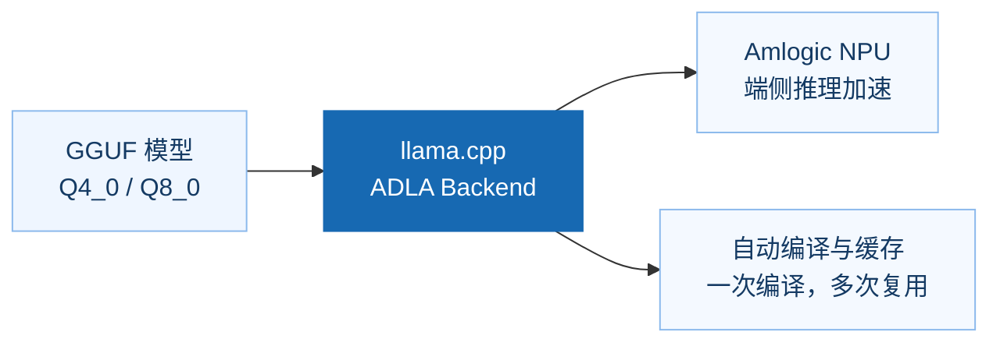
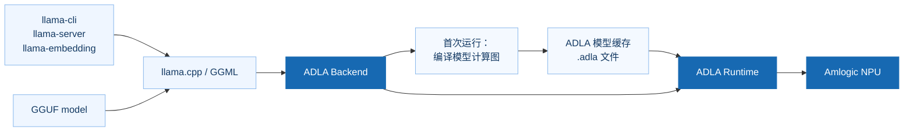

# llama.cpp ADLA NPU 版本

本包用于在 Amlogic ADLA NPU 上运行 llama.cpp，

**让 llama.cpp 与 Amlogic NPU 协同工作，简化端侧大模型部署。**



- **原生融入 llama.cpp**：通过 ADLA Backend 对接 llama.cpp，沿用熟悉的 GGUF 模型和工具链。
- **释放端侧 NPU 算力**：将支持的模型计算交由 Amlogic ADLA NPU 加速，服务端侧 LLM 与 Embedding 应用。
- **开箱即用的模型部署**：首次推理自动编译并缓存模型，后续运行直接复用；也可在 x86 上预编译后部署到板端。
- **灵活的应用接入**：支持命令行和服务模式，覆盖对话、文本生成及 Embedding 场景。

### 架构



### 环境要求
- 芯片：A311Y3
- NNSDK：v1.2.0 或更高版本
- 模型：GGUF 格式，量化权重支持 Q4_0、Q8_0
- 磁盘空间：编译时每个模型需要约 1–4 GB 临时空间
- 系统：Amlbian (Debian)

## 2. 使用方法

### 2.1 快速开始
[下载预编译文件](https://github.com/Amlogic-NN/amlnn-llama.cpp/releases/tag/v0.7.0-aml) 

```sh
cd aarch64
export LD_LIBRARY_PATH=$(pwd):$LD_LIBRARY_PATH
export GGML_ADLA_OUTPUT_DIR=$PWD/adla_output

# 文本生成
./llama-cli -m /path/Qwen3-0.6B-Q8_0.gguf -ngl 99 -p "你好" -n 64

# OpenAI 兼容服务
./llama-server -m /path/Qwen3-0.6B-Q8_0.gguf -ngl 99 --port 8080

# 取 embedding
./llama-embedding -m /path/embeddinggemma-2-Q8_0.gguf -ngl 99 \
    -p "some text" -b 512 -c 512 --embd-normalize -1
```

模型第一次运行时会把产物写进 `GGML_ADLA_OUTPUT_DIR`（对话模型一到三分钟，
长上下文 embedding 更久），之后直接复用。

### 2.2 入口程序

| 程序 | 用途 |
|---|---|
| `llama-cli` | 交互式或单次生成 |
| `llama-server` | HTTP 接口（`/v1/chat/completions`、`/v1/completions`、`/v1/embeddings`） |
| `llama-embedding` | 直接输出 embedding 向量 |
| `llama-simple` | 最小示例，用来确认环境是否可用 |

`-ngl 99` 表示把模型放到 NPU 上。**不要加 `-dev ADLA`**：把设备列表限定成单个加速器会把 CPU
回退从调度器里去掉，后端不执行的算子就会读到上一轮的数据，输出退化成乱码，解码速度也会变慢。


### 2.3 环境变量

| 变量 | 含义 |
|---|---|
| `GGML_ADLA_OUTPUT_DIR` | 产物缓存目录，默认 `./adla_output/` |
| `GGML_ADLA_MODEL_NAME` | 覆盖缓存文件名前缀（默认取 GGUF 的 `general.name` 加量化） |

### 2.4 产物缓存规则

产物名为 `<模型名>_<量化>_<图键>_....adla`，其中模型名和量化来自 GGUF
（`general.name`、`general.file_type`）。每个模型一组文件：

| 模型 | 文件数 | 体积 |
|---|---|---|
| Qwen3-0.6B | 30 | 854 MB |
| Qwen3.5-0.8B | 8 | 1.3 GB |
| MiniCPM5-1B | 26 | 1.5 GB |
| VLLM-D3-Lite | 8 | 1.3 GB |
| EmbeddingGemma2 | 3 | 3.3 GB |

删除目录即强制重新生成；换量化会得到不同前缀，不会误用旧文件。

### 2.5 在 x86 主机上预先生成产物

`scripts/adla-compile.sh` 会在 x86 主机上把每个模型跑一次，从而生成整套产物
（不需要 NPU）。生成完把目录拷到板端，用 `GGML_ADLA_OUTPUT_DIR` 指过去即可。

```sh
# 先编辑 models.txt：name|模型路径|mode|ctx   （mode 取 chat 或 embed）
./scripts/adla-compile.sh -d x86 -o adla_output -m scripts/models.txt
```

脚本对每个模型打印一行：耗时、文件数、体积。每个模型运行期间需要 1-4 GB 空闲磁盘。

## 3. 性能

以下数据在 a9 开发板（16 GiB 内存）上测得，产物已生成，温度 0。

### 3.1 文本生成

prefill 指提示词处理速度，decode 指生成阶段速度（单位都是 token/s）。
测量条件：512 token 提示词，生成 32 token。

| 模型 | 量化 | prefill (tok/s) | decode (tok/s) |
|---|---|---|---|
| Qwen3-0.6B | Q8_0 | 62 | 15 |
| Qwen3.5-0.8B | Q8_0 | 172 | 14 |
| MiniCPM5-1B | Q8_0 | 78 | 14 |


prefill 随提示词长度线性增长；decode 在上下文落在注意力窗口内时基本恒定，
超出后需要跨窗口搬运 KV，速度会下降。

### 3.2 Embedding

单条输入端到端耗时（含分词和池化）：

| 输入 token 数 | 耗时 |
|---|---|
| 128 | 0.16 s |
| 512 | 0.64 s |
| 1024 | 3.5 s |
| 2048 | 7.8 s |
| 4096 | 16.7 s |

**说明**：以上时间为llama-server 第2次以后的请求测得（模型已经加载并预热），第一次请求会包含模型加载时间。

用 `llama-server` 提供 embedding 服务时，`-ub` 要不小于你预期的最长输入（例如 `-ub 4096`）。
默认微批较小，请求过长会报 "input is too large ... increase the physical batch size"。

## 4. 数值稳定性

### 4.1 为什么与 CPU 结果不完全一致

ADLA NPU 执行的指令序列和 CPU 不同：权重重排、层间激活以较低精度保存、大矩阵乘的
累加顺序也不同。因此在该平台上无法与 CPU 参考做到逐位相同。差异只落在低位上，
所以下面的指标看的是**结果是否一致**（token 是否相同、embedding 的余弦相似度），
而不是逐位比较。

### 4.2 文本生成

贪心解码只看"token 是否相同"，不足以说明采样器在候选分数接近时会怎么选。
下面这组指标描述的是采样器每一步看到的 token 分布，对比对象是同一模型、同一提示词
在主机的 CPU 运行结果。

| 指标 | 含义 |
|---|---|
| top-1 | 概率最高的 token 是否相同 |
| 饱和 | top-1 概率 >= 0.9，此时 top-p 只能选中它，该步与后端无关 |
| TVD | 两个 softmax 分布的全变差距离；任何单个 token 被选中的概率差都不会超过这个值 |
| 核集 | top-p (0.9) 候选集合的 Jaccard 重合度 |
| 同抽一致率 | Σ p_i·q_i，两个后端各采样一次抽到同一 token 的概率 |

测量条件：512 token 提示词，温度 0；参考对象是同一 llama.cpp 版本的纯 CPU 构建
（不含 NPU，且与后端不共享代码路径）。

| 模型 | 步数 | top-1 | 饱和步数 | TVD 中位数 | TVD 最大值 | 核集重合 | 同抽一致率 |
|---|---|---|---|---|---|---|---|
| Qwen3-0.6B | 13 | 13/13 | 12/13 | 0.0029 | 0.172 | 0.96 | 0.98 |
| Qwen3.5-0.8B | 14 | 14/14 | 13/14 | 0.0025 | 0.117 | 0.96 | 0.99 |
| MiniCPM5-1B | 13 | 13/13 | 12/13 | 0.0023 | 0.126 | 0.96 | 0.98 |


怎么读这张表：

- 12-13 个步被 top-1 饱和，这些步的采样不可能分叉。
- 其余步的 TVD 中位数约 0.3%：token 顺序不变，只是概率有轻微偏移。
- TVD 最大值（0.12-0.17）出现在 prefill 之后的头几步，那里前几名候选分数接近，
  但采样到的 token 仍然相同。


已验证范围是 512 token prefill、数十个解码步。更长上下文可以运行，但没有纳入本次测量，
请视为"数值接近"而非"逐 token 相同"。上下文建议不超过模型声明值或 8k 的 80%，
超出后精度会明显下降。

### 4.3 EmbeddingGemma2

与主机 CPU（llama.cpp v0.7.0）同模型的对比，双方 embedding 均做 L2 归一化：

| 输入 token 数 | 余弦相似度 | 最大绝对误差 | 平均绝对误差 |
|---|---|---|---|
| 128 | 0.99957646 | 8.51e-03 | 7.72e-04 |
| 256 | 0.99948436 | 9.05e-03 | 8.30e-04 |
| 512 | 0.99932283 | 7.54e-03 | 1.00e-03 |
| 1024 | 0.99927455 | 8.79e-03 | 1.03e-03 |
| 2048 | 0.99885305 | 1.07e-02 | 1.31e-03 |
| 4096 | 0.99824468 | 1.36e-02 | 1.61e-03 |

整个测试范围内余弦都在 0.998 以上。向量与 CPU 不逐位相同，检索类应用请用相似度
阈值（0.99 以上）判断，不要做精确比较。

## 5. 支持的模型

| 模型 | 量化 | 支持情况 | 备注 |
|---|---|---|---|
| Qwen3-0.6B | Q8_0 | 支持 | |
| Qwen3.5-0.8B | Q8_0 | 支持 | |
| MiniCPM5-1B | Q8_0 | 支持 | |
| VLLM-D3-Lite | Q8_0 | 实验性 | - |
| EmbeddingGemma2 | Q8_0 | 支持 | 上下文最长 4096 token |

## 6. 已知限制

- 长上下文 embedding 首次需要生成 1.6 GB 的产物，耗时几分钟。
- NPU 路径依赖板端镜像提供的驱动库，本包不包含。
- `VLLM-D3-Lite` 为实验性支持，不保证运行稳定和输出正确。
- 多模态输入mmproj 模型暂未支持 (CPU运行)
